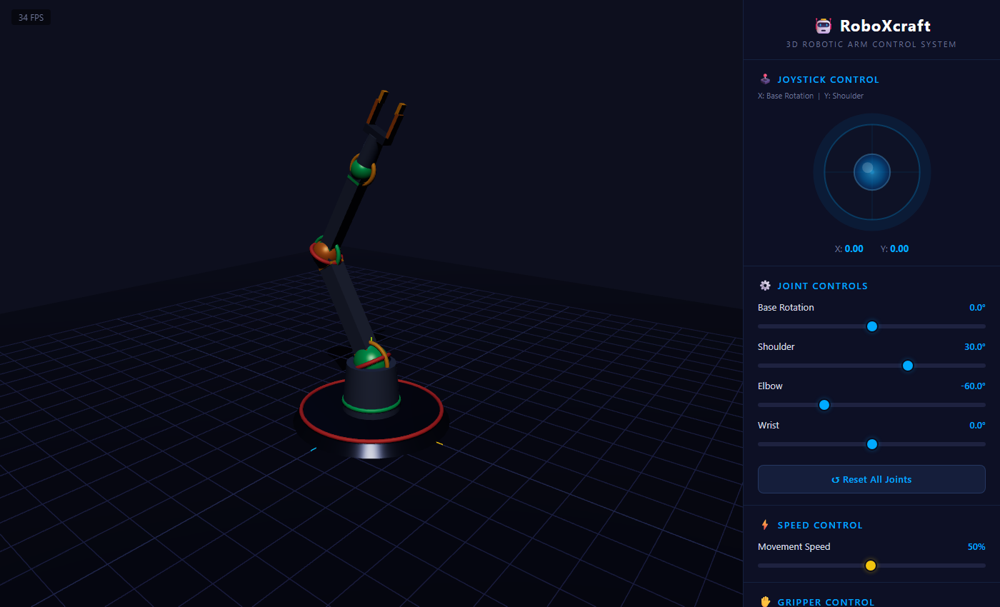
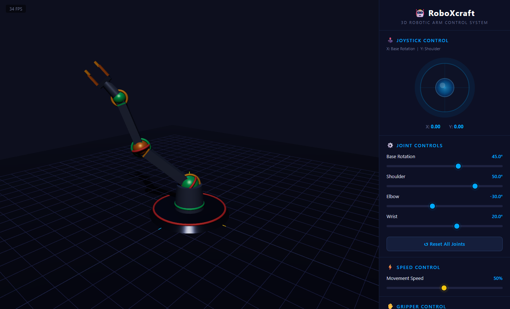
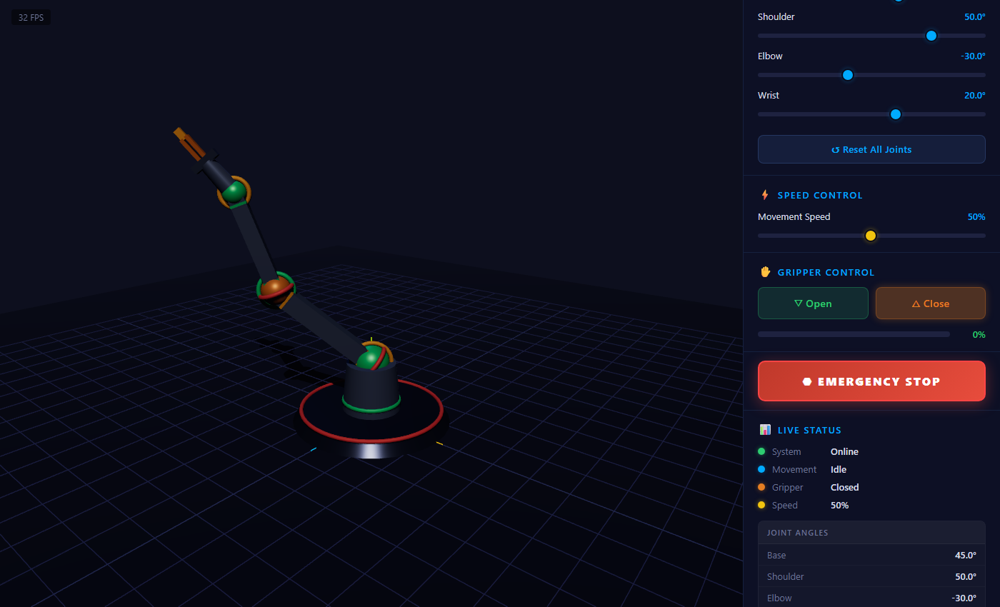
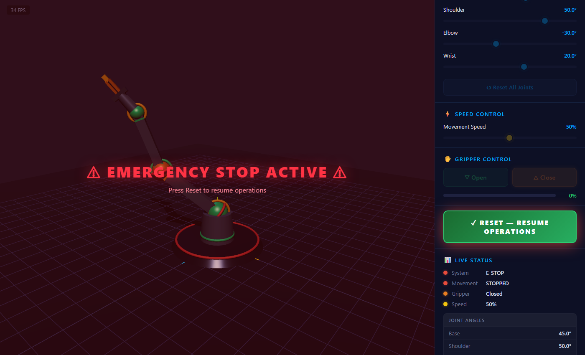
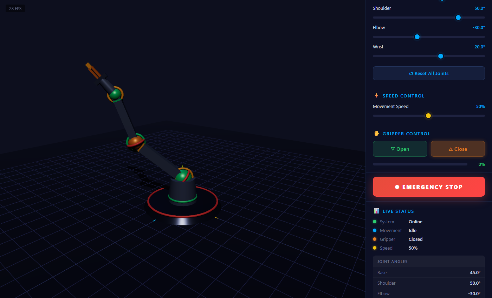

# 🤖 RoboXcraft — 3D Web-Based Robotic Arm Control System

A fully interactive 3D robotic arm simulation and control system that runs entirely in the web browser. Built with **Three.js** for real-time 3D rendering and vanilla JavaScript for a responsive, modern control interface.

---

## 🌐 Live Working Website & Repository

- **Live Deployed Website**: [https://ibaibhav0.github.io/roboxcraft-3D-Web-Based-Robotic-Arm-Control-System/](https://ibaibhav0.github.io/roboxcraft-3D-Web-Based-Robotic-Arm-Control-System/)
- **GitHub Repository**: [https://github.com/ibaibhav0/roboxcraft-3D-Web-Based-Robotic-Arm-Control-System](https://github.com/ibaibhav0/roboxcraft-3D-Web-Based-Robotic-Arm-Control-System)
- **Local Application URL**: `http://localhost:8080`



---

## ✨ Features

### 1. 3D Robotic Arm Visualization
- Multi-segment articulated arm: **base → turret → shoulder → upper arm → elbow → forearm → wrist → gripper**
- Realistic metallic materials with shadows and lighting
- Coloured joint spheres and decorative torus rings (green, red, orange)
- Grid floor with coordinate axes for spatial reference
- Full orbit camera: **left-click** to rotate, **scroll** to zoom, **right-click** to pan

### 2. Virtual Joystick Control
- Canvas-based joystick with mouse and touch support
- **X-axis**: drives base rotation
- **Y-axis**: drives shoulder angle
- Real-time X/Y readout display
- Visual feedback with glow effects when active

### 3. Joint Control Sliders
| Joint | Range |
|-------|-------|
| Base Rotation | -180° to +180° |
| Shoulder | -90° to +90° |
| Elbow | -135° to +135° |
| Wrist | -90° to +90° |

Each slider shows its current angle in real time. A **Reset All Joints** button returns to defaults.

### 4. Speed Control
- Slider from **1% to 100%** controlling joystick movement sensitivity
- Affects how fast the arm responds to joystick input

### 5. Gripper Control
- **Open** / **Close** buttons with smooth animated transitions
- Visual progress bar showing gripper open percentage
- Finger movement visible in the 3D viewport

### 6. Emergency Stop
- Prominent red **EMERGENCY STOP** button
- Immediately halts all arm movements
- Disables all controls (sliders, gripper, joystick)
- Red pulsing overlay on the 3D viewport
- Click again to **Reset** and resume operations

### 7. Live Status Dashboard
Real-time display of:
- **System status** — Online / E-STOP (with coloured indicator)
- **Movement status** — Idle / Moving / STOPPED
- **Gripper status** — Open / Closed / Partial (with percentage)
- **Speed** — Current speed percentage
- **Joint angles** — All four joint angles in a compact table

---

## 📸 Screenshots

| Full View | Joints Moved | Gripper Closed |
|-----------|-------------|----------------|
|  |  |  |

| Emergency Stop | Resumed |
|----------------|---------|
|  |  |

---

## 🛠️ Tech Stack

| Technology | Purpose |
|-----------|---------|
| **Three.js** (r160) | 3D rendering engine — scene, camera, lighting, geometry, materials, shadows |
| **JavaScript** (ES Modules) | Application logic, animation loop, UI interaction |
| **HTML5 Canvas** | Virtual joystick rendering |
| **CSS3** | Dark-themed UI with glassmorphism panels, responsive layout |

No build tools, bundlers, or frameworks required. Pure client-side web technology.

---

## 📂 Project Structure

```
RoboXcraft/
├── index.html              # Main HTML page with UI layout
├── style.css               # Dark-themed stylesheet
├── js/
│   ├── main.js             # Entry point: scene, lights, animation loop, UI bindings
│   ├── RobotArm.js         # 3D robot arm model (geometry, joints, gripper)
│   └── VirtualJoystick.js  # Canvas-based virtual joystick
├── screenshots/            # Project screenshots
└── README.md               # This file
```

---

## 🚀 How to Run

### Option 1: Python HTTP Server
```bash
cd RoboXcraft
python -m http.server 8080
# Open http://localhost:8080 in your browser
```

### Option 2: VS Code Live Server
1. Install the **Live Server** extension in VS Code
2. Right-click `index.html` → **Open with Live Server**

### Option 3: Node.js
```bash
npx serve .
```

> **Note**: The project uses ES Modules and loads Three.js from a CDN, so it must be served over HTTP (not opened directly via `file://`).

---

## 🧠 How It Works

### Architecture

```
┌────────────────────────────────────────────────────────────┐
│                        Browser                             │
│  ┌──────────────────────┐  ┌────────────────────────────┐  │
│  │    3D Viewport        │  │     Control Panel          │  │
│  │                      │  │                            │  │
│  │  Three.js Scene      │  │  Joystick (Canvas API)     │  │
│  │  ├─ Camera + Orbit   │  │  Joint Sliders (HTML)      │  │
│  │  ├─ Lights + Shadows │  │  Speed Slider              │  │
│  │  ├─ Grid + Axes      │  │  Gripper Buttons           │  │
│  │  └─ RobotArm Model   │  │  Emergency Stop            │  │
│  │     ├─ Base Pivot     │◄─┤  Live Status Display       │  │
│  │     ├─ Shoulder Pivot │  │                            │  │
│  │     ├─ Elbow Pivot    │  └────────────────────────────┘  │
│  │     ├─ Wrist Pivot    │                                  │
│  │     └─ Gripper        │  ┌────────────────────────────┐  │
│  │                      │  │     Animation Loop          │  │
│  │                      │  │  1. Read joystick input     │  │
│  └──────────────────────┘  │  2. Update joint angles     │  │
│                            │  3. Animate gripper          │  │
│                            │  4. Update status display    │  │
│                            │  5. Render frame             │  │
│                            └────────────────────────────┘  │
└────────────────────────────────────────────────────────────┘
```

### Robot Arm Hierarchy (Scene Graph)

The robotic arm is built as a **nested hierarchy of Three.js Groups**, so rotating a parent joint automatically carries all child segments:

```
group (scene root)
└── basePivot (Joint 1 — Y-axis rotation)
    ├── turret cylinder
    ├── decorative ring
    └── shoulderPivot (Joint 2 — Z-axis tilt)
        ├── shoulder sphere + accent rings
        ├── upper arm box
        └── elbowPivot (Joint 3 — Z-axis tilt)
            ├── elbow sphere + accent rings
            ├── forearm box
            └── wristPivot (Joint 4 — Z-axis tilt)
                ├── wrist sphere + ring
                ├── wrist cylinder
                └── gripperGroup
                    ├── gripper base plate
                    ├── left finger (translates along X)
                    └── right finger (translates along X)
```

### Key Concepts

1. **Forward Kinematics**: Each joint angle is applied as a rotation on its pivot group. Because of the parent-child hierarchy, changing the shoulder angle automatically moves the elbow, wrist, and gripper.

2. **Animation Loop**: A `requestAnimationFrame` loop runs at ~60 FPS, reading joystick input, updating joint rotations, interpolating the gripper position, refreshing the status UI, and rendering the scene.

3. **Emergency Stop**: Sets a flag that blocks all input processing in the animation loop. The robot freezes in its current pose until reset.

4. **Virtual Joystick**: Implemented with Pointer Events on a `<canvas>`. The stick position is normalized to [-1, 1] and multiplied by the speed factor and delta time to produce smooth, frame-rate-independent joint movement.

---

## 🎮 Controls Reference

| Control | Action |
|---------|--------|
| **Left-click drag** (3D view) | Orbit camera |
| **Scroll wheel** | Zoom in/out |
| **Right-click drag** | Pan camera |
| **Joystick drag** | Move base (X) and shoulder (Y) |
| **Joint sliders** | Directly set individual joint angles |
| **Speed slider** | Adjust joystick response speed |
| **Open / Close** | Control gripper |
| **Emergency Stop** | Halt all movement |
| **Reset All Joints** | Return to default pose |

---

## 📄 License

MIT License — free to use, modify, and distribute.
